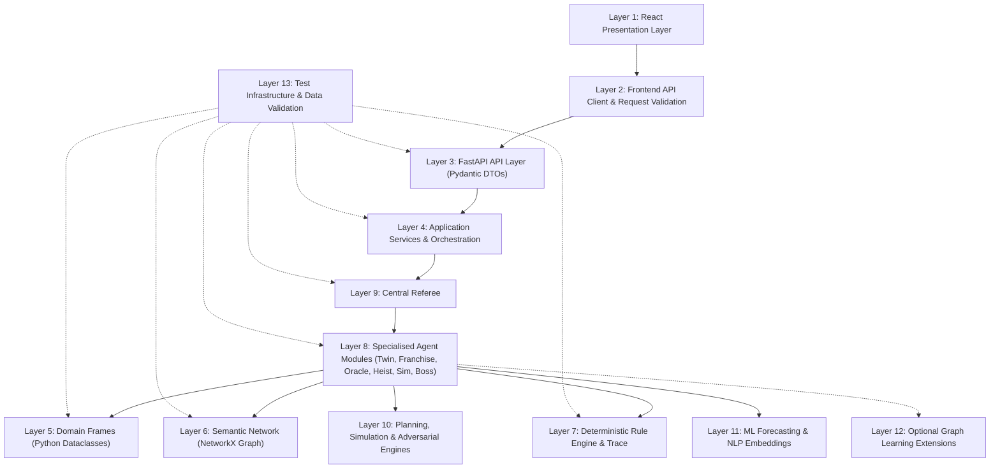
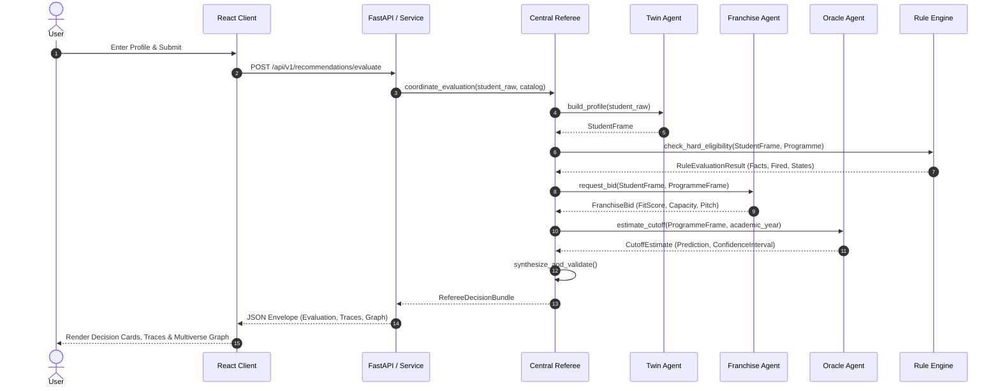

# Hydra Target Architecture Specification

**System Name**: Hydra  
**Status**: Phase 0 Architectural Baseline  
**Audience**: Software Architects, AI Engineers, Frontend Developers  

---

## 1. System Vision and Core Architecture Principles

Hydra is an explainable AI-powered academic decision-support and planning system. It helps students explore academic programmes and career pathways, evaluate their eligibility, compare alternatives, plan proactive action sequences to satisfy admission criteria, simulate possible academic futures, and stress-test these plans under adverse conditions.

### Architectural Tenets

1. **Symbolic Primacy over Statistical Guessing**: Eligibility, prerequisite satisfaction, and accreditation status are deterministic domain truths. They are adjudicated strictly by frames, semantic networks, and deterministic IF–THEN rules. Statistical ML and embeddings supply discovery signals and predictive projections, but can **never** override deterministic admission rules.
2. **Backend Exclusivity for Inference**: The React frontend is purely a presentation layer. It displays decisions, graphs, and audit traces rendered by the backend. It never implements admission rules.
3. **Referee-Centric Mediation**: The six specialised agents operate as cohesive functional modules. They communicate through the central Referee rather than unstructured peer-to-peer side-channels.
4. **Three-State Eligibility Model**: Evaluations result in `eligible`, `ineligible`, or `needs_review`. Missing information is never treated as satisfied eligibility.
5. **Decoupled Evaluation Dimensions**: Academic eligibility, financial affordability, and subjective preference fit are computed independently.
6. **Transparent Explainability**: Every evaluation outputs an auditable trace of facts used, rules evaluated, rules fired, graph paths traversed, and uncertainties encountered.

---

### Distinction: Request Flow vs. Code Dependency Direction

To maintain high maintainability and prevent framework coupling, Hydra strictly distinguishes runtime request flow from compile-time code dependencies:

```
Runtime Request Flow:
React Frontend (UI)
       │
       ▼ (HTTP JSON)
FastAPI Routers (app/api/v1/)
       │
       ▼ (Validates Pydantic DTOs)
Application Services (app/services/)
       │
       ▼ (Instantiates & coordinates)
Domain Reasoning & Knowledge (app/domain/, app/knowledge/, app/rules/, app/referee/)
       │
       ▼ (Returns domain results)
Structured API Response (Pydantic Response Envelopes)
       │
       ▼ (HTTP JSON)
React Frontend (Renders decisions, traces & graphs)
```

```
Code Dependency Principle (Compile-Time / Inward-Only):
app/api/          ──imports──▶ app/services/
app/services/     ──imports──▶ app/referee/, app/domain/, app/knowledge/, app/rules/
app/referee/      ──imports──▶ app/agents/, app/rules/, app/knowledge/, app/domain/
app/agents/       ──imports──▶ app/domain/, app/knowledge/, app/rules/, app/engines/
app/knowledge/    ──imports──▶ app/domain/
app/rules/        ──imports──▶ app/domain/
app/domain/       ──imports──▶ [Python Standard Library ONLY]
```

> **Core Isolation Directives**:
> 1. **Zero Framework Leaks**: Domain frames (`app/domain/`), rule evaluation (`app/rules/`), and semantic networks (`app/knowledge/`) must NEVER import FastAPI, Starlette, HTTP request objects, or frontend-specific types.
> 2. **Boundary DTO Separation**: API transport models (`app/api/schemas/`) are strictly separate from domain dataclasses (`app/domain/`).
> 3. **Cohesive Footprint**: Avoid sprawling abstractions or hollow empty modules created solely for architectural diagrams. Modules must remain small, cohesive, and directly purposeful.

---

## 2. Layered Architecture

Hydra organizes responsibilities into cohesive layers with strict inward dependencies.



---

### Layer-by-Layer Detailed Specifications

#### Layer 1: React Presentation Layer
- **Responsibilities**: Renders responsive, accessible UI components (student profile form, programme cards, multiverse graph visualisation, comparison matrix, adversarial stress-test results, and reasoning trace explorer).
- **Inputs**: User interactions, form inputs, route parameters, and state stores.
- **Outputs**: Rendered DOM, accessibility trees (ARIA), dispatched UI actions.
- **Dependencies**: React 19, TypeScript, Tailwind CSS, Lucide icons, Vite.
- **Forbidden**: Calculating eligibility, overriding backend status, caching business rules.

#### Layer 2: Frontend API Client and Request Validation
- **Responsibilities**: HTTP communication with the Python backend, serializing outgoing requests, validating incoming responses against TypeScript contract types, managing network state and error toasts.
- **Inputs**: Typed payload objects from frontend state hooks.
- **Outputs**: Promises of typed API responses (`ApiResponse<T>`) or structured frontend errors.
- **Dependencies**: Fetch API / Axios, TypeScript interfaces generated or mirrored from backend schemas.
- **Forbidden**: Faking backend results, swallowing error traces.

#### Layer 3: FastAPI API Layer (`backend/app/api/`)
- **Responsibilities**: Defines REST endpoints, OpenAPI documentation, request/response validation via Pydantic models (`backend/app/api/schemas/`), rate-limiting, CORS handling, and routing to application services (`backend/app/services/`).
- **Canonical Endpoints**:
  - `GET /api/health` — System health and service liveness check.
  - `GET /api/v1/programmes` — Programme catalog retrieval with explicit synthetic demonstration tags and provenance.
  - `POST /api/v1/recommendations/evaluate` — Student evaluation endpoint accepting `StudentProfileRequest` (academic subject scores with `grading_scale`, `entrance_exam_name`, `entrance_rank`, `preferred_locations`, `total_budget_inr`, `preferred_disciplines`, `career_goals`) and returning `EvaluationResponse` (programme evaluations, eligibility status `eligible`/`ineligible`/`needs_review`, affordability on total duration INR tuition basis, preference fit, evidence, rule IDs, reasoning traces, graph-discovered relationships, runtime UTC audit timestamp, and synthetic provenance).
- **Inputs**: HTTP requests (JSON payloads, query parameters).
- **Outputs**: HTTP responses with structured JSON envelopes, status codes, and error models.
- **Dependencies**: FastAPI, Pydantic v2, Starlette.
- **Forbidden**: Direct database or low-level graph mutations; business logic execution inside route handlers; alternative evaluation endpoints.

#### Layer 4: Application Services and Agent Orchestration (`backend/app/services/`)
- **Responsibilities**: Application workflow coordinators (e.g., `EvaluationService`, `ProgrammeService`). Translates API Pydantic DTOs into domain dataclass frames, manages execution lifecycles, and triggers the Referee.
- **Inputs**: Boundary DTOs, session tokens, request parameters.
- **Outputs**: Aggregated domain evaluation results, planning bundles, simulation reports.
- **Dependencies**: Central Referee (Layer 9), Domain Frames (Layer 5), Knowledge Graph (Layer 6).
- **Forbidden**: Direct UI logic, circular imports back to the API layer, implementing admission evaluation rules directly (delegated to Referee/Rules).

#### Layer 5: Student and Programme Domain Frames (`backend/app/domain/`)
- **Responsibilities**: Pure data models representing entities with structured slots, type annotations, and explicit inheritance mechanisms. Entities: `StudentFrame`, `ProgrammeFrame`, `InstitutionFrame`, `SubjectScoreFrame`, `QualificationFrame`, `SkillFrame`, `CareerFrame`. (Implemented in Phase 1; generalized inheritance deepened in Phase 2).
- **Inputs**: Instantiation arguments from catalog loaders or API parsers.
- **Outputs**: Immutable or controlled mutable dataclass instances with slot-accessor methods and slot inheritance resolvers.
- **Dependencies**: Python standard library (`dataclasses`, `typing`, `enum`, `abc`).
- **Forbidden**: External I/O, network calls, database connections, HTTP awareness, importing FastAPI or Pydantic.

#### Layer 6: Semantic Network and Knowledge Representation (`backend/app/knowledge/`)
- **Responsibilities**: Maintains a typed, directed multigraph representing entities (nodes) and academic relationships (edges) in `backend/app/knowledge/graph.py` and `traversal.py`. Examples: `(Programme)-[:REQUIRES_SUBJECT]->(Subject)`, `(Programme)-[:DEVELOPS_SKILL]->(Skill)`, `(Skill)-[:RELEVANT_FOR]->(Career)`, `(Programme)-[:OFFERED_BY]->(Institution)`. Supports path discovery, neighbor queries, and bounded traversal.
- **Phase Boundary**: In Phase 1, includes a minimal NetworkX semantic network with at least one genuine graph traversal returning related skills/careers. Phase 2 expands and deepens multi-hop graph reasoning and dynamic ontology queries.
- **Inputs**: Entity frames and relationship triples.
- **Outputs**: Subgraphs, relationship paths, inherited properties, adjacent nodes.
- **Dependencies**: NetworkX, Layer 5 (Domain Frames).
- **Forbidden**: Unbounded graph traversals, global singleton mutation during requests. (Note: Terminology is standardized as the knowledge representation layer; do not conflate with application orchestration services).

#### Layer 7: Deterministic Rule Engine and Inference Trace (`backend/app/rules/`)
- **Responsibilities**: Pure IF–THEN rule evaluation system in `backend/app/rules/engine.py` and `traces.py`. Evaluates prerequisite rules, entrance exam ranks, subject minimums, quota caps, and fee thresholds. Captures an immutable `InferenceTrace` recording: rules evaluated, conditions checked, rules fired, facts used, outcomes, and plain-language justifications.
- **Phase Boundary**: In Phase 1, provides a focused, deterministic IF–THEN evaluator for major decision paths. Phase 2 deepens into reusable rule-engine abstractions, rule priority resolution, and multi-source conflict handling.
- **Inputs**: `StudentFrame`, `ProgrammeFrame`, and relevant subgraph.
- **Outputs**: `RuleEvaluationResult` containing boolean satisfaction flags, diagnostic reasons, and audit traces.
- **Dependencies**: Layer 5 (Domain Frames).
- **Forbidden**: Non-deterministic randomness, external network calls, statistical guessing.

#### Layer 8: Six Specialised Agent Modules (`backend/app/agents/`)
- **Responsibilities**: Distinct functional modules (Twin, Franchise, Oracle, Heist Planner, Simulator, Boss-Fight). Each encapsulates a single domain concern and communicates exclusively with the Referee.
- **Inputs**: Read-only domain frames and scoped subgraphs delivered via Referee requests.
- **Outputs**: Structured Agent Proposal/Report objects (`TwinProfile`, `FranchiseBid`, `OracleCutoffEstimate`, `HeistPlan`, `SimulationScenario`, `StressTestAudit`).
- **Dependencies**: Layers 5, 6, 7, and specialized engines (Layers 10, 11).
- **Forbidden**: Mutual peer-to-peer direct mutation or invocation; writing to shared global variables.

#### Layer 9: Central Referee (`backend/app/referee/`)
- **Responsibilities**: The central arbitrator and validation authority. Dispatches tasks to agents, cross-examines agent proposals against the Rule Engine and Knowledge Graph, reconciles bids, flags contradictions, and synthesizes the final consolidated decision.
- **Inputs**: Student profile requests, candidate programme lists, agent proposal outputs.
- **Outputs**: `RefereeDecisionBundle` containing final verified eligibility states, preference rankings, affordability assessments, and comprehensive auditable traces.
- **Dependencies**: Layers 5, 6, 7, 8.
- **Forbidden**: Blind trust in predictive models; treating missing facts as passed requirements.

#### Layer 10: Planning, Simulation and Adversarial Evaluation (`backend/app/engines/`)
- **Responsibilities**: 
  - **Planning Engine**: Forward state-space search and A* algorithms to identify paths from deficient student states to qualified states (introduced in Phase 6).
  - **Simulation Engine**: Branching scenario generation for counterfactual analysis (introduced in Phase 7).
  - **Adversarial Engine**: Stress-testing plans against stochastic shocks (introduced in Phase 7).
- **Inputs**: Current student state, target goal state, transition actions, perturbation parameters.
- **Outputs**: Action plans, scenario branching trees, plan resilience/survival scores.
- **Dependencies**: Layers 5, 6, 7.
- **Forbidden**: Modifying baseline historical records or authoritative rules.

#### Layer 11: ML Forecasting and Natural-Language Understanding
- **Responsibilities**: Provides predictive admissions cutoff ranges using regression/time-series forecasting (Oracle Agent, introduced in Phase 8) and semantic matching between student interests and programme descriptions using sentence embeddings (Interest Decoder, introduced in Phase 9).
- **Inputs**: Historical admissions datasets, unstructured student interest statements, programme syllabi.
- **Outputs**: `CutoffEstimate` (with confidence intervals $[P_{10}, P_{50}, P_{90}]$) and `SemanticSimilarityScore`.
- **Dependencies**: scikit-learn / pandas (Phase 8), sentence-transformers / PyTorch (Phase 9).
- **Forbidden**: Overriding hard eligibility rules; reporting point estimates without uncertainty margins.

#### Layer 12: Optional Graph-Learning and Learning-Bidder Extensions
- **Responsibilities**: Optional future enhancements (e.g., node embeddings via Node2Vec/PyG for inductive link prediction between novel skills and emerging career pathways, reinforcement learning for bidder tuning, introduced optionally in Phase 9).
- **Inputs**: Knowledge graph snapshots, historical evaluation logs.
- **Outputs**: Link recommendations, tuned bidder weights.
- **Dependencies**: PyTorch Geometric / DGL (Deferred to Phase 9).
- **Forbidden**: Required dependency for baseline system functionality.

#### Layer 13: Test Infrastructure and Data Validation (`backend/tests/`)
- **Responsibilities**: Automated test suites in `tests/unit/` and `tests/integration/` validating unit correctness, contract adherence, rule firing, regression prevention, and end-to-end integration flows. Synthetic data generators with strict validation tags.
- **Inputs**: Test cases, synthetic fixtures, mock frame datasets.
- **Outputs**: Test reports, coverage metrics, contract validation statuses.
- **Dependencies**: pytest, pytest-cov, httpx, Vitest, Testing Library.
- **Forbidden**: Mocking away rule engine verification in integration tests.

---

## 3. Dependency Rules and Anti-Patterns

```
Allowed Direct Compile-Time Dependencies:
Layer 1 (UI)            -> Layer 2 (API Client)
Layer 2 (API Client)    -> Layer 3 (FastAPI via HTTP contracts)
Layer 3 (FastAPI API)   -> Layer 4 (Application Services)
Layer 4 (Services)      -> Layer 9 (Referee), Layer 5 (Frames), Layer 6 (Knowledge Graph)
Layer 9 (Referee)       -> Layer 8 (Agents), Layer 7 (Rules), Layer 6 (Knowledge Graph), Layer 5 (Frames)
Layer 8 (Agents)        -> Layer 5 (Frames), Layer 6 (Knowledge Graph), Layer 7 (Rules), Layer 10/11 (Engines)
Layer 7 (Rules)         -> Layer 5 (Frames)
Layer 6 (Knowledge)     -> Layer 5 (Frames)
Layer 10, 11 (Engines)  -> Layer 5 (Frames), Layer 6 (Knowledge Graph)
```

### Strict Architectural Boundaries

1. **No Inward-to-Outward Leaks**: Core reasoning (`app/domain/`, `app/knowledge/`, `app/rules/`, `app/referee/`) must NEVER import outer frameworks (FastAPI, Starlette, Pydantic HTTP schemas, or frontend libraries).
2. **Boundary DTO Separation**: API transport models (`app/api/schemas/`) are strictly isolated from domain dataclasses (`app/domain/`).
3. **No Circular Imports**: Backend modules must follow strict acyclic hierarchy: `domain (frames) -> knowledge / rules -> agents / engines -> referee -> services -> api`.
4. **No Business Logic in API Routes**: FastAPI routes only deserialize, invoke services, and serialize.
5. **No Inference in Frontend**: If the backend is unavailable or returns an error, the frontend displays an error state; it never falls back to local client-side evaluation rules.
6. **No Direct Agent-to-Agent Coupling**: Agent A must never import or invoke Agent B directly. All multi-agent choreography runs through the Referee.
7. **Separation of Verified Facts vs. Estimates**: Every data model exposing an ML prediction must carry an `is_estimate: True` flag and confidence bounds.
8. **Small, Cohesive Modules**: Avoid bloated "utils" or hollow layers. Modules should be small, single-responsibility Python files.

---

## 4. Knowledge Representation: Frames, Semantic Network, and Inheritance

### Frame Representation (Python Dataclasses)

Entities are represented as strongly-typed Python dataclasses. Each frame defines its canonical slots, using India-focused academic structures and INR currency:

- **`StudentFrame`**:
  - `student_id: str`
  - `subject_scores: List[SubjectScoreFrame]`
  - `entrance_exam_name: Optional[str]` (e.g., `"JEE Main"`, `"MHT-CET"`, `"KCET"`, or `None`)
  - `entrance_rank: Optional[int]` (e.g., `24500` or `None`)
  - `preferred_locations: List[str]` (e.g., `["Karnataka", "Maharashtra"]`)
  - `total_budget_inr: float` (e.g., `800000.0` for ₹8,00,000)
  - `preferred_disciplines: List[str]` (e.g., `["Computer Science", "Data Science"]`)
  - `career_goals: List[str]` (e.g., `["Software Engineer", "Data Scientist"]`)

- **`SubjectScoreFrame`**:
  - `subject_code: str` (e.g., `"MATH"`, `"PHYS"`, `"CHEM"`, `"ENG"`)
  - `subject_name: str`
  - `score: float` (e.g., `85.0`)
  - `max_score: float` (e.g., `100.0`)
  - `grading_scale: str` (e.g., `"percentage"`, `"cbse_10_point"`)

- **`ProgrammeFrame`**:
  - `programme_id: str` (e.g., `"SYNTH_IN_CS_01"`)
  - `title: str` (e.g., `"B.Tech. in Computer Science (Synthetic)"`)
  - `institution_id: str`
  - `institution_name: str` (Synthetic fictional name, e.g., `"Demo Institute of Technology, Bengaluru"`)
  - `state_location: str` (e.g., `"Karnataka"`)
  - `degree_level: str` (e.g., `"Undergraduate"`)
  - `duration_years: int` (e.g., `4`)
  - `annual_tuition_inr: float` (e.g., `150000.0` for ₹1,50,000/yr)
  - `estimated_total_tuition_inr: float` (`annual_tuition_inr * duration_years` = `600000.0` for ₹6,00,000)
  - `currency: str = "INR"`
  - `cost_basis: str = "tuition_only_total"`
  - `mandatory_subjects: Dict[str, float]` (e.g., `{"MATH": 80.0, "ENG": 70.0}`)
  - `accepted_entrance_exams: List[str]` (e.g., `["JEE Main", "KCET"]`)
  - `cutoff_rank: Optional[int]`
  - `quota: int`
  - `is_synthetic: bool = True`
  - `dataset_label: str = "SYNTHETIC_DEMO_CATALOG_NOT_OFFICIAL"`
  - `provenance: str = "SYNTHETIC_DEMO_RECORD_V1"`

- **`InstitutionFrame`**:
  - `institution_id: str`, `name: str`, `state: str`, `country: str = "India"`, `default_currency: str = "INR"`, `accreditation_status: str`, `is_synthetic: bool = True`.

### Grading Scale Normalization & Budget Semantics Guard

1. **No Silent Grading Scale Conflation**: Different grading systems (such as standard percentage vs. 10-point CGPA) must not be compared directly. In Phase 1, if a student submits a score with a grading scale incompatible with the programme benchmark without an explicit verified mapping rule, the evaluation MUST produce `needs_review`.
2. **Explicit Budget and Cost Semantics**: All financial comparisons use **INR** and cover the entire programme duration time basis (`total_budget_inr` vs. `estimated_total_tuition_inr`). The cost is explicitly labeled as `cost_basis: "tuition_only_total"`. Undocumented exchange-rate conversions are forbidden.

### Semantic Network (NetworkX MultiDiGraph)

The knowledge graph models domain relationships with typed, directed edges:

| Source Entity | Relation Type | Target Entity | Edge Properties |
|---|---|---|---|
| `Programme` | `OFFERED_BY` | `Institution` | `campus`, `delivery_mode` |
| `Programme` | `REQUIRES_SUBJECT` | `Subject` | `minimum_score`, `grading_scale`, `is_mandatory` |
| `Programme` | `DEVELOPS_SKILL` | `Skill` | `proficiency_level` |
| `Skill` | `LEADS_TO_CAREER` | `Career` | `relevance_weight` |
| `Programme` | `BELONGS_TO_FACULTY` | `Faculty` | `primary: bool` |
| `Subject` | `PREREQUISITE_FOR` | `Subject` | `strict: bool` |

### Explicit Inheritance Mechanism & Phase 2 Generalised Frame System

Phase 2 deepens the frame architecture into a generalized symbolic knowledge core (`backend/app/domain/frame_system.py` and `backend/app/rules/expressions.py`):
- **Canonical Frame Registry (`FrameRegistry`)**: Central registry managing frame definitions, parent validation, topological inheritance ordering, and directed cycle prevention (`_detect_cycle`).
- **Slot Merging Policies (`MergePolicy`)**:
  - `OVERRIDE`: Child slot explicitly replaces any inherited ancestor value.
  - `MERGE_UNIQUE`: For collection slots (skills, careers), generates a deterministic, sorted, deduplicated union across all parents and child declarations.
  - `REQUIRE_CONSISTENCY`: Flags a conflict if multiple parents provide different scalar values without explicit child resolution.
- **Conflict Handling & Provenance**: Multiple parents with differing values produce structured `ConflictRecord`s. Explicit child overrides mark conflicts as resolved with auditable provenance paths (`[Child -> Parent -> Root]`). Unresolved decision-relevant conflicts propagate directly to `needs_review`.
- **Defaults vs. Verified Facts**: Inherited default slots (`SlotSourceType.INHERITED_DEFAULT`) represent descriptive structural templates and can never satisfy mandatory student prerequisites.
- **Requirement Expression AST (`backend/app/rules/expressions.py`)**:
  - Prerequisite benchmarks are modeled as abstract syntax trees: atomic nodes (`SubjectScoreRequirement`, `EntranceRankRequirement`, `CertificationRequirement`) and composite logical nodes (`AllOf` conjunction, `AnyOf` disjunction).
  - Deterministic **Three-Valued Logic** (`SATISFIED`, `VIOLATED`, `NEEDS_REVIEW`) allows expressive alternative admission pathways, e.g.: `(Math >= 80% AND Physics >= 75%) OR (JEE Main rank <= 15000)`.
  - Evaluations produce a hierarchical `ReasoningTreeNode` and flattened `RuleEvaluationRecord` for 100% backward compatibility.

### Admissions Knowledge Base and Data Provenance (Phase 3)

Phase 3 introduces an authoritative admissions knowledge base completely decoupled from the synthetic demonstration catalogue:

1. **Strict Four-Tier Data Classification**:
   - `official_source`: Verified primary artifacts retrieved directly from authoritative bodies (e.g. JEE Advanced Office), backed by immutable SHA-256 checksums and UTC retrieval timestamps.
   - `derived_from_official`: Normalized records with complete evidentiary provenance tracing directly to a verified official source document. Format-inspired fixtures are classified as `synthetic_demo`, never `derived_from_official`.
   - `synthetic_demo`: Explicitly synthetic fixtures (`is_synthetic: True`) for testing the symbolic reasoning engine and data pipelines.
   - `unverified`: Registered portal endpoints whose remote artifacts could not be retrieved due to network constraints (e.g. JoSAA NIC SSL handshake timeouts).

2. **Decoupling Historical Cutoffs from Eligibility**:
   - **Historical Cutoff Observations** (`AdmissionCutoffObservation`): Describe historical allocation boundaries from past counselling rounds. They **never** act as mandatory student eligibility rules or admission guarantees.
   - **Formal Eligibility Criteria** (`FormalEligibilityCriterion`): Verified, deterministic prerequisite rules published by official authorities.

3. **Ingestion, Snapshotting, and Quarantine Pipeline**:
   - Deterministic normalisation (`app/knowledge/ingestion/normaliser.py`).
   - Strict boundary and duplicate validation (`app/knowledge/ingestion/validator.py`).
   - Quarantined records partitioned into `data/quarantine/*.jsonl` with machine-readable error codes.
   - Immutable dataset snapshots (`DatasetSnapshot`) created per ingestion run.

4. **Provenance Registry (`ProvenanceRegistry`)**:
   - Manages `data/manifests/sources.json` and `data/manifests/snapshots.json`.
   - Computes reproducible SHA-256 checksums on demand.

---

## 5. Agent Contracts and Conceptual Interfaces



### 1. Twin Agent (Phase 4 Implementation)
- **Responsibility**: Constructs, validates, and maintains the student's structured digital twin (`TwinSnapshot`). Normalizes diverse grading systems (percentages, marks ratios, CBSE 10-point CGPA) into standardized score representations using deterministic, explainable rules. Identifies academic strengths and missing or unstated facts.
- **Required Inputs**: Raw student profile payload (`StudentProfileRequest` / `StudentFrame`): academic transcript with grading scales, entrance examination name and rank, total education budget in INR, geographic location preferences, academic disciplines, career goals, and certifications.
- **Knowledge Core Integration**:
  - `FRAME_STUDENT_BASE` registered in `FrameRegistry` providing inherited defaults (`currency: INR`, `cost_basis: tuition_only_total`, `status: active`).
  - Child instance frame `FRAME_STUDENT_{twin_id}` resolving explicit student slots with auditable provenance paths.
  - Bounded traversal of `HydraKnowledgeGraph` discovering verified pathways connecting student career goals and disciplines to academic programmes and skills.
- **Typed Fact Provenance**:
  - Every attribute is modeled as an atomic `FactRecord` with origin category:
    - `USER_PROVIDED`: Directly provided by applicant in input payload.
    - `DETERMINISTICALLY_DERIVED`: Computed via deterministic symbolic policy (e.g. `CBSE_CGPA_X_9_5`, `MARKS_RATIO_NORMALIZATION`, `PERCENTAGE_RATIO`).
    - `EXTERNAL_VERIFIED`: Authoritatively verified against external cryptographically signed document.
    - `UNKNOWN`: Unstated, missing, or unattempted fields.
- **Conservative Grading Scale Normalization**:
  - `percentage`: Valid for $[0, max\_score]$.
  - `marks_obtained_out_of_total`: Normalized via explicit marks ratio rule.
  - `cbse_10_point`: Official formula $\text{Percentage} = \text{CGPA} \times 9.5$, strictly avoiding erroneous $\times 10$ conversions.
  - Unsupported scales (e.g., US 4-point GPA, letter grades): Raw score preserved, normalized percentage set to `None`, validation status flagged as `NEEDS_REVIEW`.
  - Out-of-bounds scores: Marked `INVALID`.
- **Zero Predictive Speculation**:
  - The Twin Agent strictly reports verified user facts. Unattempted or unprovided entrance exam ranks are recorded with `rank = None` and `missing_details = ["entrance_rank"]`. It never estimates future ranks or predicts aptitude percentiles.
- **Multidimensional Completeness Engine**:
  - Assesses completeness independently across 5 dimensions (`academic`, `entrance_exam`, `financial`, `geographic`, `interests_and_career`).
  - Decoupled from programme eligibility: completeness measures data sufficiency for planning, whereas eligibility verifies rule satisfaction against specific programme prerequisite cutoffs.
- **Deterministic Fingerprinting & Immutability**:
  - Generates reproducible canonical SHA-256 fingerprint from sorted, normalized input attributes, producing stable snapshot identifiers (`TWIN_{fingerprint[:12]}`).
- **Outputs Returned**: Immutable `TwinSnapshot` containing dimensional completeness assessments, normalized academic transcript, entrance exam profile, financial constraints, geographic preferences, verified graph pathways, resolved frame slots, and complete fact provenance records.
- **Errors / Uncertainties**: `UNRECOGNIZED_GRADING_SCHEME`, `INCOMPLETE_PROFILE_DATA`, `AMBIGUOUS_SUBJECT_MAPPING`.
- **Explicit Non-Responsibilities**: Does not decide admission eligibility; does not rank programmes; does not search for action plans.

### 2. Franchise Agents
- **Responsibility**: Represents an individual academic programme. Evaluates how well a student matches the programme's pedagogical profile, capacity, and academic strengths, producing a structured "suitability bid".
- **Required Inputs**: Validated `StudentFrame`, its own `ProgrammeFrame`.
- **Shared Knowledge Read**: Programme curriculum graph, skill development outcomes.
- **Outputs Returned**: `FranchiseBid` containing suitability score $[0.0, 1.0]$, component breakdown (academic fit, career alignment), capacity status, and tailored programme rationale.
- **Errors / Uncertainties**: `CURRICULUM_DATA_MISSING`, `CAPACITY_UNDEFINED`.
- **Explicit Non-Responsibilities**: Cannot overrule the deterministic rule engine; cannot grant waivers independently; does not forecast future university-wide cutoff movements.

### 3. Oracle Agent
- **Responsibility**: Predicts future admission cutoffs and competitive score thresholds using historical admissions trends and forecasting models.
- **Required Inputs**: Programme identifier, target admission cycle/year, historical cutoff series.
- **Shared Knowledge Read**: Historical admissions cutoff records, institutional historical intake statistics.
- **Outputs Returned**: `OraclePrediction` containing estimated cutoff value, confidence interval (e.g., 90% prediction interval $[P_{10}, P_{90}]$), trend direction (rising, stable, declining), and data provenance.
- **Errors / Uncertainties**: `INSUFFICIENT_HISTORICAL_DATA`, `HIGH_VARIANCE_PREDICTION`, `REGIME_CHANGE_DETECTED`.
- **Explicit Non-Responsibilities**: Does NOT verify actual applicant prerequisite compliance; does NOT certify official university cutoffs.

### 4. Heist Planner Agent
- **Responsibility**: Formulates step-by-step action plans to bridge prerequisite deficiencies or competitive score gaps. Identifies prerequisite chains and remedial milestones (e.g., summer calculus courses, portfolio requirements).
- **Required Inputs**: Current `StudentFrame`, target `ProgrammeFrame`, specific deficiencies identified by the Rule Engine.
- **Shared Knowledge Read**: Prerequisite graph, alternative credential equivalencies, course availability calendars.
- **Outputs Returned**: `HeistPlan` containing ordered sequence of actions, estimated duration, cost, difficulty rating, and resulting post-plan eligibility state.
- **Errors / Uncertainties**: `UNREACHABLE_GOAL_STATE`, `NO_VIABLE_TRANSITION_PATH`, `DEADLINE_VIOLATION`.
- **Explicit Non-Responsibilities**: Does not evaluate whether the student is currently eligible without the plan; does not simulate macroeconomic shocks.

### 5. Simulator Agent
- **Responsibility**: Simulates alternative academic scenarios and explores "what-if" counterfactuals (e.g., "What if math final score improves to 88%?", "What if the student switches target career to Data Science?", "What if tuition rises by 15%?").
- **Required Inputs**: Base `StudentFrame`, base `ProgrammeFrame`, set of hypothesized parameter perturbations.
- **Shared Knowledge Read**: Full semantic network, rule set, fee schedule models.
- **Outputs Returned**: `SimulationReport` detailing state transitions, delta in eligibility, delta in affordability, and comparative ranking shifts across simulated branches.
- **Errors / Uncertainties**: `INVALID_PERTURBATION_PARAMETER`, `DIVERGENT_SCENARIO_STATE`.
- **Explicit Non-Responsibilities**: Does not generate adversarial worst-case attacks (reserved for Boss-Fight); does not issue definitive admissions verdicts.

### 6. Boss-Fight Agent
- **Responsibility**: Acts as an adversarial stress-tester. Introduces hostile environmental perturbations and realistic shocks (e.g., 10% sudden drop in final examination score, severe currency devaluation impacting tuition, sharp 5-point cutoff spike due to sudden quota cuts) to evaluate plan fragility.
- **Required Inputs**: Candidate `HeistPlan` or selected academic pathway, `StudentFrame`, `ProgrammeFrame`.
- **Shared Knowledge Read**: Volatility distributions, historical economic/grade shock patterns.
- **Outputs Returned**: `StressTestAudit` containing survival score $[0.0, 1.0]$, identified single-point-of-failure vulnerabilities, and plan robustness rating (`Resilient`, `Fragile`, `Vulnerable`).
- **Errors / Uncertainties**: `UNREALISTIC_SHOCK_MAGNITUDE`, `NON_TESTABLE_PLAN`.
- **Explicit Non-Responsibilities**: Does not build initial plans; does not provide friendly optimization; does not decide baseline admission rules.

---

## 6. The Central Referee: Arbitration & Trace Protocol

The Central Referee serves as the orchestrator and supreme arbiter:

```
[Agent Proposals] + [Rule Engine Results] + [Knowledge Graph Paths]
                                |
                                v
                     [Referee Arbitration]
                                |
             +------------------+------------------+
             |                                     |
   (Validation Checks)                    (Synthesis & Trace)
   - Mandatory rules satisfied?           - Three-state eligibility
   - Missing required facts?              - Affordability status
   - Conflicting claims?                  - Preference fit rank
   - Model prediction bounds?             - Full immutable audit trace
```

### Referee Decision Synthesis Rules

1. **Rule Supremacy**: If Rule Engine marks a prerequisite violated $\rightarrow$ Eligibility is strictly `ineligible`, regardless of high Franchise Agent bids or optimistic Oracle predictions.
2. **Missing Fact Integrity**: If any mandatory prerequisite fact is unknown or missing $\rightarrow$ Eligibility is strictly `needs_review`. Missing facts are NEVER assumed satisfied.
3. **Affordability Decoupling**: Evaluates whether `total_budget_inr >= estimated_total_tuition_inr` (on a tuition-only total duration basis in INR). If an applicant is academically `eligible`, but total tuition exceeds the student's budget $\rightarrow$ State: `eligible: true`, `is_affordable: false` (`cost_basis: "tuition_only_total"`).
4. **Predictive Demarcation**: Oracle forecasts are presented as future admission probabilities, strictly distinct from current rule verification.
5. **Auditable Trace Packaging**: The Referee produces an immutable `InferenceTrace` containing:
   - Evaluated fact keys and values (including scores, grading scales, entrance ranks)
   - Specific rule IDs executed and fired
   - Agent outputs received and confidence levels
   - Graph relationships traversed via genuine NetworkX queries
   - Missing facts and unresolved uncertainties
   - Plain-language justifications for every determination
   - Dynamic runtime UTC audit timestamp (`audit_timestamp` in ISO 8601)

