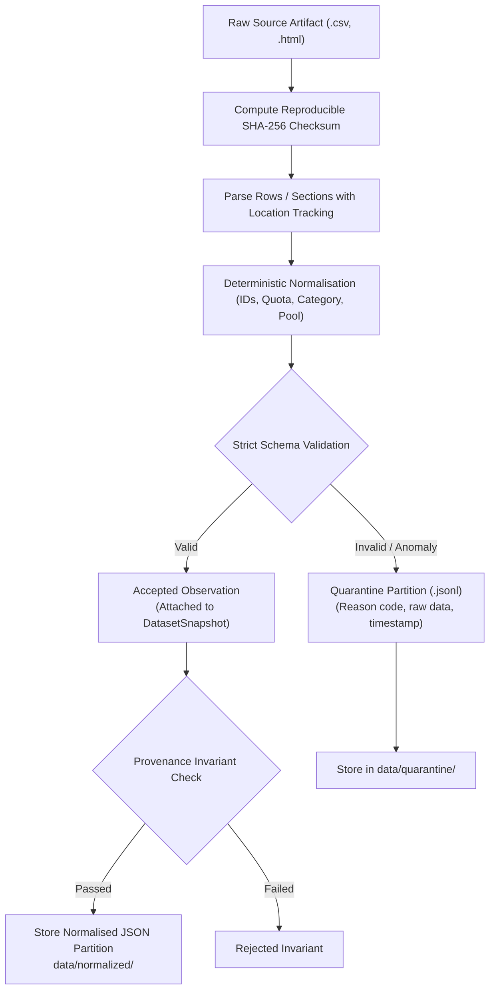

# DATA_PROVENANCE.md — Admissions Knowledge Base & Data Provenance Protocol for Hydra

This document establishes the architecture, provenance model, validation pipeline, and domain boundaries governing all admissions data ingested into **Hydra** (Phase 3 & Phase 3.1).

---

## 1. Core Principles & Demarcation

Hydra maintains a strict architectural partition between source authenticity, record origin, and schema validation status:

1. **Official Sources (`official_source`)**:
   - Primary authoritative artifacts directly retrieved from official examination and counselling authorities (e.g., JEE Advanced Office / Joint Admission Board).
   - Backed by authentic raw files, UTC retrieval timestamps, and immutable SHA-256 checksums.
2. **Records Derived from Official (`derived_from_official`)**:
   - Normalized records that can be traced through an immutable ingestion snapshot directly to a verified official source document with a matching SHA-256 checksum and reproducible row/section location.
   - Requires `is_synthetic: False`. Cannot be claimed by test fixtures or unverified sources.
3. **Synthetic Demonstration Fixtures (`synthetic_demo`)**:
   - Explicitly tagged with `is_synthetic: True`, `source_status: "synthetic_demo"`.
   - Used for testing parsers, boundary validation, and symbolic reasoning ASTs.
   - **Critical Rule**: A fixture that resembles an official CSV export format is **NOT** derived from official data. Format compatibility does not constitute evidence of authoritative fact.
4. **Unverified Sources (`unverified`)**:
   - Authoritative sources registered in the manifest whose remote assets could not be retrieved due to network constraints or government firewall/handshake timeouts (e.g., NIC portal SSL timeouts).
   - Never upgraded to official status without an authentic downloaded artifact and matching checksum.

---

## 2. Invariant: Source Authenticity vs. Record Origin vs. Validation Status

Hydra decouples three orthogonal dimensions:
- **Source Authenticity**: Is the publisher authoritative, and is the source document verified on disk? (`official_source`, `synthetic_demo`, `unverified`)
- **Record Origin**: Where did the normalized record originate? (`derived_from_official`, `synthetic_demo`, `unverified`)
- **Validation Status**: Did the record pass structural schema constraints? (`valid`, `quarantined`)

An invalid row from an official source is quarantined with error codes; a valid row in a synthetic test fixture remains purely synthetic.

---

## 3. Critical Domain Distinction: Historical Cutoff Observations vs. Eligibility

> [!IMPORTANT]
> **A historical opening or closing rank is an observed allocation boundary from past counselling rounds. It is NEVER a mandatory student eligibility prerequisite or an admission guarantee.**

- **Historical Cutoff Observations**: Describe what happened in prior counselling cycles for a specific quota, seat category, and gender pool.
- **Formal Eligibility Criteria**: Deterministic, verified rules published by examination boards that govern whether a student is legally eligible to be considered.
- **Symbolic Core Decoupling**: Historical cutoffs are queryable through `/api/v1/admissions/cutoffs` with a mandatory legal disclaimer and are **never** injected into the student prerequisite AST evaluated by `EvaluationService`.

---

## 4. Scope of JEE (Advanced) Eligibility Criteria

The criteria extracted from `SRC_JEEADV_2026_ELIGIBILITY` (`https://jeeadv.ac.in/eligibility.html`) govern **eligibility to appear for the JEE (Advanced) 2026 examination**:
- `Criterion A1`: Performance in JEE (Main) 2026 (top 2,50,000 successful candidates).
- `Criterion A2`: Age Limit (born on or after October 1, 2001, with 5-year relaxation for SC/ST/PwD).
- `Criterion A3`: Number of attempts (maximum of two times in consecutive years).
- `Criterion A4`: Appearance in Class XII (or equivalent) in 2025 or 2026 with Physics, Chemistry, and Mathematics.
- `Criterion A5`: Prior admission to an IIT (candidate should NOT have been admitted previously).

**Explicit Scope**: These rules carry `criterion_scope: "exam_appearance_eligibility"` and `target_examination: "JEE (Advanced)"`. They do not represent institutional degree admission requirements or guarantee university seat allocation.

---

## 5. Registered Sources and JoSAA Retrieval Limitation

| Source ID | Issuing Authority | Canonical URL | Type | Status | Artifact / Checksum |
| :--- | :--- | :--- | :--- | :--- | :--- |
| `SRC_JEEADV_2026_ELIGIBILITY` | Joint Admission Board (JAB) / JEE (Advanced) Office | `https://jeeadv.ac.in/eligibility.html` | HTML Webpage | `official_source` | `data/raw/jeeadv/2026/eligibility.html`<br>`d64c3026e63cd6f618eb7ee76a84db8ce80d5de4f21c4307ba7210b05c20374a` |
| `SRC_JOSAA_2026_ORCR` | Joint Seat Allocation Authority (JoSAA) / NIC | `https://josaa.nic.in/document/opening-and-closing-ranks-2026/` | Public Portal | `unverified` | Registered awaiting manual artifact provision (NIC SSL handshake timeout in automated environment) |
| `SRC_JOSAA_2026_SEAT_MATRIX` | Joint Seat Allocation Authority (JoSAA) / NIC | `https://josaa.nic.in/seat-matrix/` | Public Portal | `unverified` | Registered awaiting manual artifact provision (NIC SSL handshake timeout in automated environment) |
| `SRC_JOSAA_2026_BUSINESS_RULES` | Joint Seat Allocation Authority (JoSAA) | `https://josaa.nic.in/information-bulletin/` | Bulletin PDF | `unverified` | Registered awaiting manual artifact provision (NIC SSL handshake timeout in automated environment) |
| `SRC_JOSAA_SYNTHETIC_FIXTURE_2026` | Hydra Test Suite (Synthetic Illustrative Fixture) | `https://josaa.nic.in/document/opening-and-closing-ranks-2026/` | CSV Export | `synthetic_demo` | `data/raw/josaa/fixtures/josaa_orcr_fixture_round1_2026.csv`<br>`cc0a9a766d345b967e060ab8a7601c207ccf2246e08631f875b86795685d5132` |

> [!NOTE]
> **JoSAA NIC Portal Limitation**: Live access to `https://josaa.nic.in` times out during automated Python retrieval due to NIC's legacy SSL handshake configuration. In accordance with Hydra's zero-fabrication directive, the official JoSAA endpoints remain explicitly registered as `unverified`. The local CSV fixture (`SRC_JOSAA_SYNTHETIC_FIXTURE_2026`) is explicitly classified as `synthetic_demo` with `is_synthetic: True`. Its illustrative values (such as IIT Bombay CSE closing rank 67) must never be presented as verified published counselling outcomes.

---

## 6. Ingestion, Validation, and Quarantine Pipeline

Every ingestion execution enforces deterministic normalisation and record-level schema validation:



### Validation Rules and Error Codes
- `VAL_REQ_INSTITUTION`: Official institution name missing or empty.
- `VAL_REQ_PROGRAMME`: Official programme title missing or empty.
- `VAL_YEAR_INVALID` / `VAL_YEAR_OUT_OF_BOUNDS`: Academic year not a valid integer within 2015–2035.
- `VAL_ROUND_INVALID` / `VAL_ROUND_OUT_OF_BOUNDS`: Counselling round not an integer within 1–10.
- `VAL_RANK_NON_POSITIVE`: Opening or closing rank $\le 0$.
- `VAL_RANK_ORDER_INVERTED`: Opening rank $>$ Closing rank under the same rank basis.
- `VAL_DUPLICATE_RECORD`: Duplicate record identified on composite key `(institution, programme, quota, seat_type, gender, round, year)`.

### Provenance Invariant Rule Codes
- `PROV_SYNTHETIC_OFFICIAL_CONFLICT`: Record is marked synthetic but claims `derived_from_official` or `official_source`.
- `PROV_DERIVED_WITHOUT_OFFICIAL_SOURCE`: Record claims `derived_from_official` but references a non-official source document.
- `PROV_MISSING_ARTIFACT_OR_CHECKSUM`: Source document lacks verified file artifact or SHA-256 checksum.
- `PROV_CHECKSUM_MISMATCH`: Snapshot checksum does not match source document checksum.
- `PROV_MISSING_ROW_LOCATION`: Record lacks reproducible row-level source provenance.

---

## 7. Dataset Snapshots and Reproducibility

Each ingestion run produces an immutable `DatasetSnapshot` record:
- **Snapshot ID Formula**: `SNAP_{DATASET}_{YEAR}_{CHECKSUM_SHORT}_{IMPORTER_VERSION}`
- **Immutability**: Changing a raw file produces a completely distinct snapshot identifier; previous historical import evidence is never silently overwritten.
- **Reproducible Commands**:
  ```powershell
  # Import JoSAA Synthetic Fixture Cutoffs
  $env:PYTHONPATH='backend'; .\.venv\Scripts\python.exe -c "
  from app.knowledge.provenance_registry import ProvenanceRegistry
  from app.knowledge.ingestion.importer_josaa import JoSAAImporter
  reg = ProvenanceRegistry()
  doc = reg.get_source('SRC_JOSAA_SYNTHETIC_FIXTURE_2026')
  importer = JoSAAImporter(registry=reg)
  cutoffs, snap, rep = importer.import_csv('data/raw/josaa/fixtures/josaa_orcr_fixture_round1_2026.csv', doc, 2026)
  print(f'Ingested {len(cutoffs)} cutoffs. Snapshot: {snap.snapshot_id}')
  "

  # Import JEE Advanced Official Eligibility Criteria
  $env:PYTHONPATH='backend'; .\.venv\Scripts\python.exe -c "
  from app.knowledge.provenance_registry import ProvenanceRegistry
  from app.knowledge.ingestion.importer_jeeadv import JEEAdvancedEligibilityImporter
  reg = ProvenanceRegistry()
  doc = reg.get_source('SRC_JEEADV_2026_ELIGIBILITY')
  importer = JEEAdvancedEligibilityImporter(registry=reg)
  criteria, snap = importer.import_html('data/raw/jeeadv/2026/eligibility.html', doc, 2026)
  print(f'Ingested {len(criteria)} criteria. Snapshot: {snap.snapshot_id}')
  "
  ```

---

## 8. Admissions Knowledge Base API Endpoints

- `GET /api/v1/data-sources`: List registered source documents.
  - Query parameters: `status` (`official_source`, `synthetic_demo`, `unverified`).
- `GET /api/v1/data-sources/{source_id}`: Retrieve metadata for a single source.
- `GET /api/v1/data-sources/{source_id}/snapshots`: Retrieve all snapshots produced from a source.
- `GET /api/v1/admissions/cutoffs`: Query historical cutoff observations.
  - Query parameters: `academic_year`, `institution`, `programme`, `counselling_round`, `seat_type`, `quota`, `rank_basis`, `source_status`, `is_synthetic`, `limit`, `offset`.
  - Response includes mandatory `disclaimer`: *"Historical cutoff observations describe past counselling outcomes. They do not guarantee future admission."*
- `GET /api/v1/admissions/programmes`: Query derived academic programme offerings.
  - Query parameters: `academic_year`, `institution`, `is_synthetic`, `limit`, `offset`.
- `GET /api/v1/admissions/eligibility-criteria`: Retrieve formal verified criteria from official bodies.
  - Query parameters: `academic_year`, `criterion_scope`.


