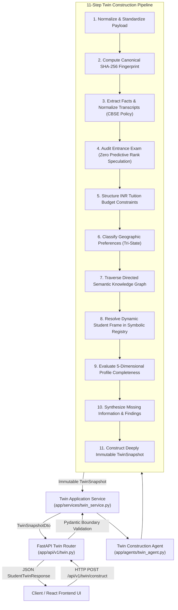

# HYDRA — ENGINEERING IMPLEMENTATION WALKTHROUGH & ARCHITECTURAL GUIDE

**System Name**: Hydra — Explainable Multi-Agent Academic Decision Support System  
**Lead Architect & Engineer**: AI Agentic Coding Assistant (Antigravity)  
**Project Owner**: Shubham Chowdhury  
**Milestone**: M001: Phase 4.1 — Twin Agent Semantic and Integrity Corrections  
**Test Suite Status**: 140 Passed / 0 Failed (100% Passing)  
**Frontend Production Build**: Clean (0 TypeScript Errors, 0 Packaging Warnings)  

---

## 1. Executive Overview & System Architecture

Hydra is an evidence-aware, explainable decision-support platform designed to assist Indian higher education applicants navigating engineering and scientific admissions. Unlike black-box generative AI chatbots or opaque algorithmic rankers, Hydra is founded on **Symbolic Artificial Intelligence**, **Typed Fact Provenance**, **Deterministic Rule Inference**, and **Strict Factual Non-Fabrication**.

Every conclusion presented to a student must have an auditable reasoning trace detailing:
1. Exactly what facts were inspected.
2. The authoritative origin and validation status of those facts.
3. The deterministic rules or knowledge graph pathways evaluated.
4. The exact regulatory or institutional policies governing derivations.



---

## 2. Core Domain Models & Data Structures (`app/domain/twin.py`)

Hydra decouples internal domain representations (structured Python dataclasses in `app/domain/`) from external transport schemas (Pydantic DTOs in `app/api/schemas/`).

### 2.1 Fact Record & Typed Origin Taxonomy

Every atomic piece of data in Hydra is represented as a `FactRecord`. This prevents raw user claims from being conflated with authoritative facts or derived figures.

```python
@dataclass(frozen=True)
class FactRecord:
    fact_id: str
    field_name: str
    actual_value: Any
    original_value: Any
    unit_or_scale: Optional[str] = None
    origin_category: FactOriginCategory = FactOriginCategory.USER_PROVIDED
    validation_status: FactValidationStatus = FactValidationStatus.VALID
    explanation: str = ""
    evidence_reference: Optional[str] = None
    input_fact_ids: List[str] = field(default_factory=list)
    derivation_rule: Optional[str] = None
```

#### The Four Origin Categories (`FactOriginCategory`)
- `USER_PROVIDED`: Raw, unverified inputs submitted by the student (e.g., self-reported board marks, declared entrance rank, budget).
- `DETERMINISTICALLY_DERIVED`: A value computed through a pure, deterministic mathematical or logical rule from one or more upstream facts (e.g., normalized percentage ratio, policy-governed CGPA conversion). It records its input fact IDs and derivation rule name.
- `EXTERNAL_VERIFIED`: Data authenticated against an official authority or verifiable record (e.g., JoSAA published closing rank list, NTA scorecard verification). Client payloads can **never** self-assign this origin category.
- `UNKNOWN`: Required or queried data that was omitted or remains unstated (e.g., student did not report an entrance examination rank).

#### The Four Validation Statuses (`FactValidationStatus`)
- `VALID`: Structurally compliant, within valid numerical/domain bounds, and satisfied by explicit evidence.
- `NEEDS_REVIEW`: Ambiguous context, unsupported scale, or missing policy linkage requiring manual human transcript audit.
- `INVALID`: Formally violated bounds (e.g., score > max score, negative ranks, CGPA > 10.0).
- `MISSING`: Critical required attribute not provided.

---

### 2.2 Policy-Aware CBSE CGPA Normalization (`CBSEConversionPolicy`)

#### Regulatory Context
A common pitfall in Indian admissions software is the naive assumption that all CBSE 10-point CGPA scores can universally and officially be converted to percentages via `percentage = CGPA * 9.5`.

Under Indian educational law and official CBSE notifications:
1. **CBSE Examination Bylaws Rule 44** and **CBSE Notification dated 30-Nov-2023** (`Calculation_Percentage_Class_X_XII_30112023.pdf`):
   > *"No overall division/distinction/aggregate shall be awarded by the Board. If percentage of marks is required for admission or employment, the calculation if any, shall be done by the admitting institution/employer."*
2. The formula $\text{Percentage} = \text{CGPA} \times 9.5$ was an **indicative guideline** issued by CBSE during the Class X Continuous and Comprehensive Evaluation (CCE) scheme (2009–2017), derived from the average marks of candidates in the 91–100 score band.
3. Today, admitting institutions may establish their own conversion policies or require subject-specific evaluations.

#### Implementation in Phase 4.1
Hydra models this through `CBSEConversionPolicy`:
- The raw CGPA is always preserved as the authoritative `original_value`.
- Automatic normalization to percentage using the 9.5 multiplier is **only performed** when the applicable institutional policy context is established:
  `conversion_policy_id = "CBSE_CCE_9_5_INDICATIVE"`.
- When policy context is present, Hydra derives the normalized percentage, assigns derivation rule `CBSE_CGPA_X_9_5_INDICATIVE`, and explicitly logs the regulatory circular context in the fact explanation.
- When policy context is omitted, Hydra retains the raw CGPA score, sets `normalized_percentage = None`, sets `conversion_status = NEEDS_REVIEW`, and logs a finding requiring transcript review. Out-of-bounds scores ($< 0.0$ or $> 10.0$) yield `INVALID`.

---

### 2.3 Geographic Semantics (`GeographicPreferenceType`)

Previous iterations modeled geographic constraints as a binary boolean `is_unconstrained`. This suffered from an epistemic defect: an empty location list was conflated with an affirmative student desire to study anywhere in India.

Phase 4.1 introduces the tri-state enum `GeographicPreferenceType`:
1. `PREFERRED_LOCATIONS`: The applicant specified one or more states/cities (e.g., `["Karnataka", "Maharashtra"]`). Geographic filtering is active.
2. `ANYWHERE_IN_INDIA`: The applicant affirmatively confirmed openness to institutions anywhere in India (e.g., `["anywhere in india"]`). Unfiltered by explicit choice.
3. `NOT_PROVIDED`: The applicant provided no location preferences. Hydra treats this data **neutrally**—programmes across all regions are presented without geographical exclusion, but the profile explicitly documents that preferences were not declared.

---

### 2.4 Score-Based Academic Highlights (`AcademicIdentity`)

To uphold domain integrity, subject scores exceeding a threshold must never be described as "inferred cognitive strengths", "general aptitude", or "innate intelligence".

1. **Renamed Field**: `score_based_academic_highlights` (with `academic_strengths` retained as a backward-compatible alias).
2. **Explicit Heuristic Metadata**:
   - `highlight_threshold: float = 75.0`
   - `highlight_heuristic_version: str = "1.0"`
3. **UI Disclaimer**: Every display of highlights includes an explicit disclaimer stating that this represents transcript score performance exceeding Hydra's heuristic threshold ($\ge 75.0\%$), not broader cognitive or aptitude evaluation.

---

### 2.5 Deep Immutability & Process-Bound Identity (`TwinSnapshot`)

A `TwinSnapshot` represents a frozen, tamper-proof state of the student profile at a specific point in time:
- **Canonical Fingerprint**: A deterministic SHA-256 hash of sorted, canonicalized profile elements (subjects sorted by code, normalized strings, fixed academic year 2026).
- **Snapshot ID**: `TWIN_{fingerprint[:12]}`.
- **Deep Collection Immutability**: While `@dataclass(frozen=True)` prevents replacing top-level attributes, nested dictionaries and lists remain mutable by default in Python. `TwinSnapshot.__post_init__` converts all internal dictionaries to read-only `MappingProxyType` instances and all internal lists to `tuple` instances. Any runtime attempt to mutate the snapshot raises `TypeError` or `AttributeError`.

---

## 3. Symbolic Frame System Isolation (`app/domain/frame_system.py`)

Hydra's Knowledge Representation layer uses Minsky-style symbolic frames.

1. **Template Frame (`FRAME_STUDENT_BASE`)**:
   - Registered once in the canonical `FrameRegistry`.
   - Defines system defaults: `currency: "INR"`, `cost_basis: "tuition_only_total"`, `status: "active"`.
2. **Dynamic Student Frame (`FRAME_STUDENT_{twin_id}`)**:
   - Created dynamically for each digital twin with parent `FRAME_STUDENT_BASE`.
   - Explicit student slots (`student_id`, `total_budget_inr`, `entrance_rank`, `preferred_locations`) are attached only to this child frame.
3. **Isolation Guarantee**:
   - Frame inheritance operates top-down via topological breadth-first resolution.
   - Dynamic student frames **never** mutate ancestor frames.
   - Verified by test `test_19_frame_system_student_isolation`: after constructing multiple twins, `FRAME_STUDENT_BASE` retains only its original default slots, preventing cross-tenant information leakage in persistent processes.

---

## 4. Directed Semantic Graph Traversal (`app/knowledge/graph.py`)

Hydra's semantic network is implemented using NetworkX (`MultiDiGraph`).

1. **Forward Graph Edge Semantics**:
   - $\text{Programme} \xrightarrow{\text{PROGRAMME\_LEADS\_TO\_CAREER}} \text{Career}$
   - $\text{Programme} \xrightarrow{\text{PROGRAMME\_RELATED\_TO\_DISCIPLINE}} \text{Discipline}$
   - $\text{Programme} \xrightarrow{\text{PROGRAMME\_DEVELOPS\_SKILL}} \text{Skill}$
   - $\text{Skill} \xrightarrow{\text{SKILL\_RELEVANT\_TO\_CAREER}} \text{Career}$
2. **Directional Integrity During Reverse Queries**:
   - When a student provides a career ambition (e.g., "Software Engineer"), Hydra inspects incoming edges on the career node (`in_edges(career_node)`).
   - In the resulting pathway object, Hydra preserves the authentic **forward edge direction**: the academic programme or skill is reported as `source`, and the student goal is reported as `target`. The relationship is never reversed to claim "Career leads to Programme".

---

## 5. Multidimensional Completeness vs. Admissions Eligibility

Hydra strictly decouples **Profile Completeness** from **Academic Eligibility**:

| Concept | Scope | Evaluation Authority | Possible States |
|---|---|---|---|
| **Completeness** | Did the student provide enough facts to evaluate their profile? | `TwinAgent` (Phase 4) | `complete`, `partial`, `needs_review` |
| **Eligibility** | Does the student satisfy mandatory institutional admission criteria? | `RuleEngine` & `EvaluationService` (Phases 1–2) | `eligible`, `ineligible`, `needs_review` |
| **Affordability** | Does the student budget cover total duration tuition? | `EvaluationService` (Phase 1) | `affordable`, `unaffordable` |

**Invariant**: An applicant can have a 100% `COMPLETE` twin yet be `INELIGIBLE` for a programme (due to failing subject scores or cutoff ranks). Conversely, an applicant can have a `PARTIAL` twin (e.g. omitting entrance exam) yet be `ELIGIBLE` for programmes evaluating solely on board percentages.

---

## 6. Verification and Regression Test Suite

All 140 automated backend tests run cleanly with zero failures.

```
backend/tests/test_twin_agent.py (25 Tests):
  test_1_complete_student_profile_construction                       PASSED
  test_2_cbse_cgpa_10_point_scale_conversion_rule                    PASSED
  test_3_marks_obtained_ratio_normalization                          PASSED
  test_4_unsupported_grading_scale_yields_needs_review               PASSED
  test_5_out_of_bounds_score_yields_invalid                          PASSED
  test_6_typed_fact_provenance_distinction                           PASSED
  test_7_zero_predictive_rank_speculation                            PASSED
  test_8_omitted_entrance_exam_is_clean_and_non_fatal                PASSED
  test_9_financial_constraints_currency_and_cost_basis              PASSED
  test_10_geographic_preferences_unconstrained_semantics             PASSED
  test_11_semantic_network_pathway_traversal                         PASSED
  test_12_symbolic_frame_system_integration                         PASSED
  test_13_fingerprint_reproducibility_and_stability                 PASSED
  test_14_independence_of_twin_completeness_from_programme_eligibility PASSED
  test_15_api_endpoints_construct_and_get                           PASSED
  test_16_score_based_academic_highlights_threshold_and_heuristic_version PASSED
  test_17_client_verification_flag_rejection                         PASSED
  test_18_snapshot_deep_immutability                                 PASSED
  test_19_frame_system_student_isolation                             PASSED
  test_20_semantic_graph_directed_edge_fidelity                      PASSED
  test_21_cbse_unauthorized_client_policy_selection_rejected         PASSED
  test_22_snapshot_deep_recursive_immutability                       PASSED
  test_23_snapshot_identity_vs_fingerprint_lifecycle                 PASSED
  test_24_concurrent_twin_construction_and_frame_isolation          PASSED
  test_25_semantic_network_forward_direction_preserved              PASSED

Overall Pytest Execution: 140 passed in 1.40s
Frontend Production Build: built in 2.49s (0 errors, 1600 modules transformed)
```

---

## 7. Function-Level API Reference & Implementation Walkthrough

### 7.1 Universal Recursive Immutability Helpers (`app/domain/twin.py`)

#### `freeze_value(val: Any) -> Any`
- **Signature**: `freeze_value(val: Any) -> Any`
- **Purpose**: Recursively walks arbitrary data structures and transforms mutable objects into immutable, read-only Python equivalents.
- **Transformations**:
  - `dict` / `MappingProxyType` $\rightarrow$ `MappingProxyType` containing recursively frozen items.
  - `list` / `tuple` / `set` $\rightarrow$ `tuple` containing recursively frozen items.
  - Primitive scalars (`int`, `float`, `str`, `bool`, `None`) $\rightarrow$ returned unchanged.
- **Dependencies**: Python standard library `types.MappingProxyType`.
- **Side Effects**: None (pure function).
- **Error Handling**: Non-collection types pass through safely.

#### `unfreeze_value(val: Any) -> Any`
- **Signature**: `unfreeze_value(val: Any) -> Any`
- **Purpose**: Recursively reverses `freeze_value` transformations, restoring standard mutable `dict` and `list` instances required for Pydantic model serialization, FastAPI JSON responses, and dictionary formatting.
- **Transformations**:
  - `MappingProxyType` / `dict` $\rightarrow$ standard `dict`.
  - `tuple` / `list` $\rightarrow$ standard `list`.
  - Primitive scalars $\rightarrow$ returned unchanged.
- **Dependencies**: None.
- **Side Effects**: None (pure function).

---

### 7.2 Server-Side CBSE & Grading Scale Authorization (`app/domain/twin.py`)

#### `resolve_authorized_conversion_policy(board: Optional[str], grading_scale: str, examination_year: Optional[int], requested_policy_id: Optional[str] = None) -> Tuple[Optional[AuthorizedConversionPolicy], str]`
- **Signature**:
  ```python
  def resolve_authorized_conversion_policy(
      board: Optional[str],
      grading_scale: str,
      examination_year: Optional[int],
      requested_policy_id: Optional[str] = None,
  ) -> Tuple[Optional[AuthorizedConversionPolicy], str]
  ```
- **Purpose**: Enforces server-side authority over grading scale conversion rules. Client payloads may assert context (e.g. board name, exam year, requested policy ID), but the server alone verifies whether an authorized conversion policy is registered and applicable.
- **Parameters**:
  - `board`: Optional string specifying examination board (e.g., `"CBSE"`).
  - `grading_scale`: Scale identifier (e.g., `"cbse_10_point"`, `"10_point_cgpa"`).
  - `examination_year`: Year examination was taken (e.g., `2016` vs `2026`).
  - `requested_policy_id`: Optional policy identifier requested by client.
- **Returns**: `(AuthorizedConversionPolicy | None, explanation: str)`
- **Business Logic**:
  1. For `CBSE` with `2009 <= examination_year <= 2017`: Resolves `AUTHORIZED_CONVERSION_POLICIES["CBSE_HISTORICAL_CCE_INDICATIVE"]` (multiplier 9.5).
  2. For modern cohorts (e.g. 2026): Rejects client-side policy self-selection with `NEEDS_REVIEW` per CBSE Rule 44 circular (30-Nov-2023), stating that CBSE does not calculate percentages and admitting institutions establish their own policies.
  3. Returns clear human-auditable explanation citing official circulars.

---

### 7.3 Twin Construction Agent (`app/agents/twin_agent.py`)

#### `TwinAgent.construct_twin(profile: Any) -> TwinSnapshot`
- **Signature**: `construct_twin(self, profile: Any) -> TwinSnapshot`
- **Purpose**: Executes the deterministic 11-step Student Digital Twin construction pipeline.
- **Inputs**: Pydantic `StudentProfileRequest`, dictionary, or any object with `__dict__`.
- **Outputs**: Fully populated, deeply immutable `TwinSnapshot`.
- **Identity Synthesis**:
  - `profile_fingerprint`: Deterministic SHA-256 hash of canonical sorted payload.
  - `twin_id`: `f"TWIN_{fingerprint[:12]}"`.
  - `snapshot_id`: `f"SNAP_{fingerprint[:8]}_{timestamp_ms}"`.
  - `policy_version`: `"1.0.0"`.

#### `TwinAgent._resolve_student_frame(twin_id: str, snapshot_id: str, raw_data: Dict[str, Any]) -> Dict[str, Any]`
- **Signature**: `_resolve_student_frame(self, twin_id: str, snapshot_id: str, raw_data: Dict[str, Any]) -> Dict[str, Any]`
- **Purpose**: Dynamically registers a student frame child of `FRAME_STUDENT_BASE` in the symbolic `FrameRegistry` without mutating `FRAME_STUDENT_BASE`.
- **Isolation Guarantee**: Registers `frame_id = f"FRAME_STUDENT_{snapshot_id}"` for run-level isolation and aliases `f"FRAME_STUDENT_{twin_id}"` for backward-compatible lookups. `FRAME_STUDENT_BASE` retains only its 8 system default slots.

---

### 7.4 Twin Application Service (`app/services/twin_service.py`)

#### `TwinService.construct_twin(profile: Any) -> TwinSnapshot`
- **Signature**: `construct_twin(self, profile: Any) -> TwinSnapshot`
- **Purpose**: Constructs a twin via the underlying `TwinAgent`, indexing the resulting snapshot into process-bound cache by both `snapshot.twin_id` and `snapshot.snapshot_id`.
- **Storage Lifecycle**: Process-bound in-memory cache (`_snapshots_by_id` and `_snapshots_by_snapshot_id`). Persists during application runtime across requests.

#### `TwinService.get_snapshot(identifier: str) -> Optional[TwinSnapshot]`
- **Signature**: `get_snapshot(self, identifier: str) -> Optional[TwinSnapshot]`
- **Purpose**: Retrieves an existing snapshot by either `snapshot_id` or `twin_id`. Retrieval by `snapshot_id` returns that exact run; retrieval by `twin_id` returns the latest run for that student profile.

---

### 7.5 Admissions Provenance and Domain Invariant Architecture

Hydra enforces absolute truth in advertising regarding its admissions data:
1. **Official Criteria**: JEE Advanced 2026 eligibility criteria (`SRC_JEEADV_2026_ELIGIBILITY`) were extracted from an authentic downloaded official HTML artifact verified by its immutable SHA-256 checksum (`d64c3026e63cd6f618eb7ee76a84db8ce80d5de4f21c4307ba7210b05c20374a`).
2. **Synthetic Demonstration Fixtures**: JoSAA cutoff records in the current normalized dataset are generated synthetic demonstration fixtures (`SRC_JOSAA_SYNTHETIC_FIXTURE_2026`, `is_synthetic: True`).
3. **Unverified Official Remote Endpoints**: Real JoSAA opening/closing rank exports, seat matrix, and business rules remain explicitly registered as `unverified` because automated crawler requests encountered remote NIC SSL handshake timeouts.
4. **Factual Demarcation**: Synthetic JoSAA cutoff records must never be interpreted as actual historical admissions outcomes or guarantees.

---

### 7.6 CBSE Indicative Conversion vs. Institution-Authorized Policy

Hydra strictly decouples descriptive explanatory conversions from authoritative admission eligibility:
1. **Historical Indicative Equivalence (`is_indicative: True`, `is_institution_authorized: False`)**:
   - The formula $\text{Percentage} = \text{CGPA} \times 9.5$ was an advisory guideline issued by CBSE for Class X CCE (2009–2017).
   - In Hydra, it is used strictly for descriptive display in the Student Digital Twin. It carries `is_indicative = True` and an explicit notice.
   - It **does NOT** satisfy formal mandatory admission percentage requirements evaluated by `EvaluationService`.
2. **Formal Percentage-Dependent Evaluation**:
   - When evaluated against formal prerequisite expressions (`SubjectScoreRequirement`), a `cbse_10_point` grading scale without an applicable institutional conversion policy yields `NEEDS_REVIEW`.
   - The raw CGPA is preserved without speculative conflation.

---

### 7.7 Frame Registry Lifecycle and Retention Policy

1. **Dynamic Student Frame Isolation**:
   - Each snapshot constructs a run-isolated child frame: `FRAME_STUDENT_{snapshot_id}`.
   - It inherits system defaults from `FRAME_STUDENT_BASE` without mutating the parent frame.
2. **Safe Retention & Memory Bounding**:
   - Dynamic student frames are tracked in `TwinAgent._dynamic_student_frame_ids`.
   - Bounded by `max_retained_student_frames: int = 1000`. When capacity is exceeded, oldest dynamic student frames are deregistered via `FrameRegistry.deregister_frame(oldest_id)`.
   - `TwinSnapshot` preserves the fully resolved slots and inheritance provenance in its immutable `frame_representation` dictionary, ensuring historical snapshot retrieval is never affected by registry pruning.

---

## 8. Milestone M002: Franchise Agents & Simulated Programme Auction

Milestone M002 introduces the programme-specific intelligent agent subsystem:

### 8.1 Architecture & Core Responsibilities
- **Franchise Agents**: Dynamically instantiated per academic programme using `FranchiseAgentFactory`. Each agent evaluates a single student `TwinSnapshot` against its target programme.
- **Symbolic Rule Reuse**: Reuses Hydra's existing deterministic `RuleEngine` AST prerequisite evaluator; never constructs a divergent or shadow eligibility engine.
- **Affordability Decoupling**: Affordability is evaluated and preserved independently. An eligible student whose budget is below tuition remains an `UNCONDITIONAL_CANDIDATE` with an explicit affordability warning, preserving domain truth.
- **Multi-Dimensional Preference Alignment**: Evaluates 4 dimensions:
  1. Discipline Alignment [0.0, 1.0]
  2. Career Alignment [0.0, 1.0]
  3. Academic Alignment [0.0, 1.0]
  4. Geographic Alignment [0.0, 1.0] (with unconstrained = 1.0)
- **Deterministic Simulated Auction**: `AuctionService.run_auction` partitions bids into three qualification tiers:
  - **Tier 1: Unconditional Candidates**: All mandatory rules satisfied with positive evidence. Ranked by composite preference score. Tie-breaking: Affordability -> Academic Alignment -> Programme ID.
  - **Tier 2: Conditional Candidates**: Missing mandatory facts or pending review (`NEEDS_REVIEW`). Ranked by same criteria.
  - **Tier 3: No-Bid Candidates**: Prerequisite demonstrably violated (`INELIGIBLE`). Excluded from positive ranking.
- **Security & Concurrency**: Validates that all participating bids share the same `twin_id` and `snapshot_id`, preventing cross-student profile contamination.

### 8.2 Classes and Functions Walkthrough

#### `backend/app/domain/franchise.py`
- `ProposalStatus(str, Enum)`: `UNCONDITIONAL_CANDIDATE`, `CONDITIONAL_CANDIDATE`, `NO_BID`.
- `ScoringPolicy`: Versioned weighting policy (`policy_version="v1.0"`, discipline 0.35, career 0.30, academic 0.20, geographic 0.15). Enforces weight sum == 1.0 in `__post_init__`.
- `ProgrammeBid`: Immutable proposal containing `bid_id`, `agent_id`, `programme_id`, `twin_id`, `snapshot_id`, `eligibility_status`, `affordability_status`, alignment breakdown, `proposal_status`, evidence references, missing facts, warnings, and reasoning trace.
- `AuctionResult`: Deterministic auction outcome containing partitioned candidates, overall ranking items, and natural-language summary.

#### `backend/app/agents/franchise_agent.py`
- `FranchiseAgent.evaluate(twin_snapshot: TwinSnapshot) -> ProgrammeBid`:
  1. Validates input snapshot type and recovers student frame via `twin_snapshot.student_frame`.
  2. Runs `RuleEngine.evaluate` producing deterministic `InferenceTrace`.
  3. Computes `_compute_alignment(student_frame)` returning `AlignmentScores`.
  4. Classifies into `UNCONDITIONAL_CANDIDATE`, `CONDITIONAL_CANDIDATE`, or `NO_BID`.
  5. Assembles warnings (affordability, missing facts, rule violations) without overriding eligibility.
  6. Collects evidence references (`RULE:*`, `FACT:*`).
  7. Returns immutable `ProgrammeBid`.
- `FranchiseAgentFactory.create_for_programme`: Static factory method creating lightweight, correctly configured `FranchiseAgent` instances.

#### `backend/app/services/auction_service.py`
- `AuctionService.run_auction(bids: List[ProgrammeBid], scoring_policy: Optional[ScoringPolicy]) -> AuctionResult`:
  1. Validates common `twin_id` and `snapshot_id`; rejects mixed profiles or duplicate programme bids with `ValueError`.
  2. Partitions bids into Unconditional, Conditional, and No-Bid lists.
  3. Sorts Unconditional and Conditional bids by `(-composite_preference_score, affordability, -academic_alignment, programme_id)`.
  4. Builds `AuctionRankingItem` instances with transparent explanations and recorded tie-breakers.
  5. Returns structured `AuctionResult`.

#### `backend/app/services/franchise_service.py`
- `FranchiseService.evaluate_and_run_auction`: Orchestrates loading programme catalogue, creating agents via factory, generating bids, and executing the auction.
- `FranchiseService.get_available_franchises`: Returns catalogue metadata and agent IDs.

---

## 9. Milestone M003: Heist Planner using A* Forward Search

### 9.1 Architecture & Core Responsibilities
- **Goal-Directed State Space Search**: Formulates remedial action sequences to bridge prerequisite deficiencies or missing documents.
- **Immutable Planning State (`PlanningState`)**: Represented as frozensets of satisfied and unsatisfied prerequisite conditions, ensuring deterministic canonical hashing and state comparison.
- **Typed Semantic Actions (`PlanningAction`)**: Action library categorized into 6 semantic types (`ACADEMIC_COURSEWORK`, `ENTRANCE_EXAMINATION`, `DOCUMENT_VERIFICATION`, `CERTIFICATION`, `COUNSELLING_SUBMISSION`, `FINANCIAL_ARRANGEMENT`) with non-negative costs and durations in days.
- **Admissible Lower-Bound Heuristic ($h_{\max}$)**:
  $$h_{\max}(n) = \max_{c \in U(n)} \min_{a \in A_c} \text{cost}(a)$$
  and for disjunctive condition nodes:
  $$h(\text{AnyOf}(B)) = \min_{b \in B} h(b)$$
  Mathematically proved to guarantee $h(n) \le h^*(n)$, resolving the multi-condition overestimation bug of sum-of-minimums. Dijkstra fallback ($h(n) = 0$) verified.
- **Bounded Priority Queue**: Implemented using `heapq` with closed-set cycle prevention, depth limits (50), and state expansion caps (1000).

---

## 10. Milestone M004: Simulator & Adversarial Boss-Fight Agent

### 10.1 Architecture & Core Responsibilities
- **Counterfactual Sandboxing**: Clones student frame in memory via deep copies without modifying the baseline `TwinSnapshot`.
- **Domain-Bounded Monte Carlo Simulator**:
  - Simulates parameter distributions across rank, board marks, budget, and tuition.
  - Strict physical domain boundary enforcement: integer rank $\ge 1$, board scores $[0.0, 100.0]$, budget $\ge 0$, tuition $\ge 0$.
  - Empirical quantile monotonicity ($p_{10} \le p_{50} \le p_{90}$).
  - Covariance matrix positive semi-definiteness check ($\lambda_{\min} \ge -\epsilon$).
  - Explicit hypothetical tagging (`is_empirical: False`, `provenance: "HYPOTHETICAL_SIMULATION_PARAMETERS"`).
- **Adversarial Boss-Fight Agent (`BossFightAgent`)**:
  - Implements standard 6-attack battery (`RANK_WORSENS`, `TUITION_HIKED`, `BUDGET_REDUCED`, `CUTOFF_STIFFENS`, `DOCUMENT_UNOBTAINABLE`, `PREFERENCE_SHIFTS`).
  - Classifies proposal resilience (`Resilient`, `Fragile`, `Vulnerable`).
  - Discovers surviving robust alternative programmes in the catalogue if target fails.

---

## 11. Milestone M005: Oracle Agent & Admissions Cutoff Forecasting

### 11.1 Architecture & Core Responsibilities
- **Data Readiness Gate**: Verifies SHA-256 checksums and source authority. Strictly rejects synthetic demo fixtures and unverified sources. Returns explicit `INSUFFICIENT_VERIFIED_DATA` when authentic historical cutoffs are lacking.
- **Time-Series Regression**: Ordinary Least Squares (OLS) lag regression with temporal train/test split (prior years train, latest year evaluates).
- **Calibrated Uncertainty Bounds**: Computes $[p_{10}, p_{90}]$ prediction intervals based on residual standard error and standard normal quantile ($z_{0.05} = 1.645$).

---

## 12. Milestone M006: Neural Interest Decoder & GNN Assessment

### 12.1 Architecture & Core Responsibilities
- **Dual-Engine Architecture**:
  - Primary Neural Encoder: `fastembed` ONNX `sentence-transformers/all-MiniLM-L6-v2` (384-dimensional dense embeddings, 22.7M parameters) executing locally on CPU in ~25ms.
  - Baseline Fallback: `LexicalHashingEncoder` (128-dimensional character n-gram hashing on unit hypersphere) for deterministic fallback (`force_lexical=True`).
  - Operational Status: `READY_NEURAL`, `FALLBACK_TO_LEXICAL`, or `UNAVAILABLE`.
- **Tripartite Lifecycle**: Enforces `STUDENT_STATED` $\to$ `MODEL_SUGGESTED` $\to$ `USER_CONFIRMED`. No AI model can silently modify the student's digital twin without explicit user confirmation.
- **Formal GNN Evidence Gate**: Formally evaluated and rejected (<35 nodes, lacking authentic outcome data) to avoid overfitting; symbolic NetworkX traversal maintained.

---

## 13. Milestone M007: Central Referee Multi-Agent Orchestration

### 13.1 Architecture & Core Responsibilities
- **Central Multi-Agent Arbitration**: `RefereeAgent` orchestrates all 6 specialized agents, synthesizing proposals into a unified decision bundle.
- **9-Tier Decision Hierarchy**: Absolute supremacy of verified mandatory rules over auction bids, preference scores, or predictive forecasts.
- **Stale Snapshot Rejection**: Verifies SHA-256 fingerprint consistency between profile payload and snapshot ID.
- **Envelope Validation**: Mandatory `AgentResponseEnvelope` verification across all participating agents.

---

## 14. Post-M007 Technical Validation & Hardening Sprint

### 14.1 Key Enhancements Delivered
1. **Admissible Heuristic Mathematical Proof**: Proved and implemented $h_{\max}(n) = \max_{c \in U(n)} \min_{a \in A_c} \text{cost}(a)$ in `HeistPlannerAgent`.
2. **Domain Boundaries & Statistical Integrity**: Added physical bounds and covariance PSD verification in `SimulatorAgent`.
3. **Neural Embeddings Integration**: Added `fastembed` ONNX MiniLM-L6-v2 384-D dense embeddings alongside 128-D lexical fallback.
4. **Franchise Dynamic Weight Renormalization**: Evaluates heuristic weights dynamically across present dimensions (`v1.0`), eliminating score deflation, and strictly excludes `NO_BID` candidates from positive rankings.
5. **Central Referee End-to-End Wiring**: Wired all agent evaluations, stale snapshot checks, envelope verifications, and rule override protections.
6. **Frontend Complete Wiring**: All 9 navigation tabs (`evaluation`, `twin`, `franchise`, `planner`, `simulation`, `oracle`, `interests`, `referee`, `admissions`) fully wired and interactive in `App.tsx`.
7. **Verification Baseline**: **226 passing backend tests** (`pytest`), **0 errors on frontend production build** (`npm run build`).


